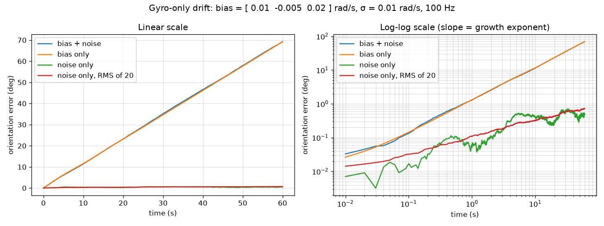

# IMU Orientation Tracker

Estimating 3D orientation from a 9-DOF IMU with filters I wrote myself (complementary → quaternion integration → Madgwick), then measuring how my estimate compares to the BNO085's onboard sensor fusion.

## Hardware
- Adafruit ESP32-S3 Feather (4MB Flash / 2MB PSRAM)
- Adafruit BNO085 9-DOF IMU, connected over I2C via STEMMA QT

## Software
- **Firmware:** C++ / Arduino framework, built with PlatformIO
- **Host:** Python (numpy, matplotlib, pyserial) for logging, filtering, and plots

## Roadmap
- [x] Gyro-drift simulation (Python): integrate a noisy, biased gyro into a quaternion and plot how the error grows
- [ ] Raw data: I2C scan, read gyro + accel at ~100 Hz, stream over serial, live plot
- [ ] Complementary filter for roll/pitch
- [ ] Quaternion gyro integration with accelerometer correction
- [ ] Madgwick filter + live 3D visualization
- [ ] Compare against the BNO085's onboard fusion (error in degrees, drift over 5 minutes)

## Results

### Gyro-only drift (simulation)
Gyro spinning at 0.5 rad/s about z, with bias `[0.01, -0.005, 0.02]` rad/s and noise σ = 0.01 rad/s at 100 Hz, integrated into a quaternion with no correction.



| case | error @ 60 s | growth (err ∝ tᵖ) |
|---|---|---|
| bias + noise | 69.3° | p = 0.97 |
| bias only | 69.2° | p = 0.97 |
| noise only (1 run) | 0.48° | p = 0.35 |
| noise only (RMS of 20 runs) | 0.73° | p = 0.46 |

- **Bias causes ~99% of the drift.** Taking the noise out barely changes anything (69.3° → 69.2°), and it grows linearly (p ≈ 1).
- **Noise grows like √t** (p ≈ 0.5), but only on average. One run is a random walk, so its fitted slope is noisy (0.35). Over 20 runs the RMS gives 0.46, close to the theory value of 0.5 (√3·σ·√(dt·t) ≈ 0.77°, measured 0.73°).
- That's almost exactly the z bias alone (0.02 × 60 = 1.2 rad ≈ 69°). The x/y bias is fixed in the spinning body frame, so it rotates with the board and mostly cancels out.
- Takeaway: integrating the gyro alone is unusable within a minute, so the filters need an absolute reference (gravity from the accelerometer, magnetic north from the magnetometer).

## Setup
```bash
python3 -m venv .venv && source .venv/bin/activate
pip install -r requirements.txt
```

Progress notes for each session are in [build-log.md](build-log.md).
