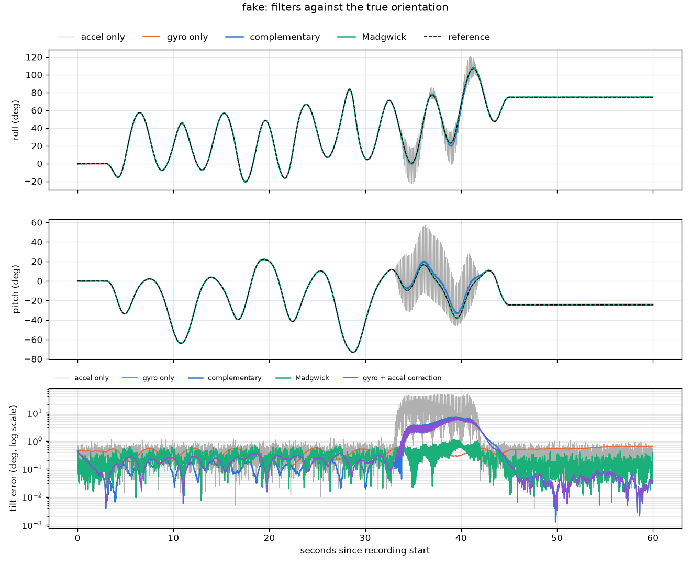

# IMU Orientation Tracker

Estimating 3D orientation from a 9-DOF IMU with filters written from scratch, no fusion library (complementary → quaternion integration → Madgwick), then measuring how my estimate compares to the BNO085's onboard sensor fusion.

## Hardware
- Adafruit ESP32-S3 Feather (4MB Flash / 2MB PSRAM)
- Adafruit BNO085 9-DOF IMU, connected over I2C via STEMMA QT

## Software
- **Firmware:** C++ / Arduino framework, built with PlatformIO
- **Host:** Python (numpy, matplotlib, pyserial) for logging, filtering, and plots

## Roadmap
- [x] Gyro-drift simulation (Python): integrate a noisy, biased gyro into a quaternion and plot how the error grows
- [x] Raw data: I2C scan, read gyro + accel at ~100 Hz, stream over serial, live plot
- [x] Complementary filter for roll/pitch
- [x] Quaternion gyro integration with accelerometer correction
- [x] Madgwick filter + live 3D visualization
- [x] Comparison tooling, checked on simulated motion with a known true orientation
- [ ] Compare against the BNO085's onboard fusion on the real board (error in degrees, drift over 5 minutes)
- [ ] Demo video

## How it works
The firmware streams three kinds of CSV rows at about 100 Hz: raw gyro (`g`), accelerometer (`a`), and the BNO085's own fused orientation (`q`, gyro + accel only). The filters run on the computer, in `host/filters.py`:

| filter | idea | knob |
|---|---|---|
| complementary | integrate the gyro into roll and pitch, then pull a small fraction toward the accelerometer's angles | τ, the crossover time |
| gyro + accel correction | integrate the gyro into a quaternion; add a rate proportional to the cross product of measured and predicted "up" | kp |
| Madgwick | the same, with the correction found by one gradient-descent step and applied at a fixed rate | β |

None of them can fix heading: gravity looks the same whichever way the board faces. Heading still drifts with whatever gyro bias is left after the start-up measurement.

| script | what it does |
|---|---|
| `host/live_plot.py <port>` | live gyro and accel plot |
| `host/record.py <port> --label x --seconds n` | save the stream to `data/<date>_x.csv` |
| `host/analyze_rest.py <csv>` | at-rest recording: timing, gyro bias and noise, gyro-only drift |
| `host/compare.py <csv>` | score every filter against the BNO085's orientation |
| `host/view3d.py <port>` | live 3D box following the Madgwick filter, BNO085 as a dashed outline |

`live_plot.py`, `compare.py` and `view3d.py` also take `--fake` to run without the board.

## Results

### Gyro-only drift (simulation)
Gyro spinning at 0.5 rad/s about z, with bias `[0.01, -0.005, 0.02]` rad/s and noise σ = 0.01 rad/s at 100 Hz, integrated into a quaternion with no correction.


| case | error @ 60 s | growth (err ∝ tᵖ) |
|---|---|---|
| bias + noise | 69.3° | p = 0.97 |
| bias only | 69.2° | p = 0.97 |
| noise only (1 run) | 0.48° | p = 0.35 |
| noise only (RMS of 20 runs) | 0.73° | p = 0.46 |

- **Bias causes ~99% of the drift.** Taking the noise out barely changes anything (69.3° → 69.2°), and it grows linearly (p ≈ 1).
- **Noise grows like √t** (p ≈ 0.5), but only on average. One run is a random walk, so its fitted slope is noisy (0.35). Over 20 runs the RMS gives 0.46, close to the theory value of 0.5 (√3·σ·√(dt·t) ≈ 0.77°, measured 0.73°).
- That's almost exactly the z bias alone (0.02 × 60 = 1.2 rad ≈ 69°). The x/y bias is fixed in the spinning body frame, so it rotates with the board and mostly cancels out.
- Takeaway: integrating the gyro alone is unusable within a minute, so the filters need an absolute reference (gravity from the accelerometer, magnetic north from the magnetometer).

### Filters on simulated motion
`host/compare.py --fake`: 60 s of made-up motion (still, tilting and turning, shaking, still again) with a known true orientation. The simulated sensors have the flaws measured on the real board: gyro bias and noise, an accelerometer that reads 3% high, and different gyro and accel rates. Gyro bias is measured over the first 2 s at rest and subtracted.



| method | tilt error RMS | tilt error max |
|---|---|---|
| accelerometer only | 8.51° | 45.79° |
| gyro only | 0.44° | 0.66° |
| complementary (τ = 1 s) | 1.69° | 7.02° |
| gyro + accel correction (kp = 1) | 1.55° | 6.55° |
| Madgwick (β = 0.1) | 0.31° | 1.12° |

- **Shaking is where they separate.** Outside the shake all three filters stay under 0.4°. During it the accelerometer alone is off by 22° RMS, the complementary filter by 4.3°, and Madgwick by 0.5°. Madgwick corrects at a fixed rate β however large the disagreement, so a violent reading can't pull it far.
- **Gyro-only looks good here only because the simulated bias is constant** and was measured at the start. Over 5 minutes with the bias left in, gyro-only tilt error reaches 91°, while Madgwick stays at 0.44° RMS.
- **Heading still drifts.** Same 5 minutes, bias left in: Madgwick's total error ends at 56°, almost all of it heading.
- **A fix that made it worse:** ignoring accelerometer samples whose length was far from 9.81 m/s² tripled the shake error (complementary 4.3° → 12.7°). The length also passes through 9.81 when the reading is gravity mirrored about the shake axis, so the samples that got through were the misleading ones.
- **Tuning** (tilt RMS): τ 0.1 → 10 s gives 2.59° → 0.93°; β 0.01 → 1 gives 0.19° → 1.18°. Less accelerometer wins on this run because the bias was removed first. On real hardware the bias wanders as the chip warms up, which pushes the best setting the other way.

These numbers are from simulation, where the reference is the true orientation. On the board the reference is the BNO085's own fusion, which has errors of its own.

### Filters on the real board
Not measured yet. To produce the numbers:
```bash
# upload the imu firmware first (it now streams q rows), close the serial monitor
.venv/bin/python host/record.py /dev/cu.usbmodem101 --seconds 300 --label move1   # still for 3 s, then move it
.venv/bin/python host/compare.py data/<date>_move1.csv
.venv/bin/python host/view3d.py /dev/cu.usbmodem101
```

## Setup
```bash
python3 -m venv .venv && source .venv/bin/activate
pip install -r requirements.txt
```

Progress notes for each session are in [build-log.md](build-log.md).
